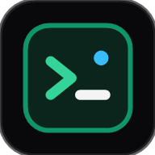
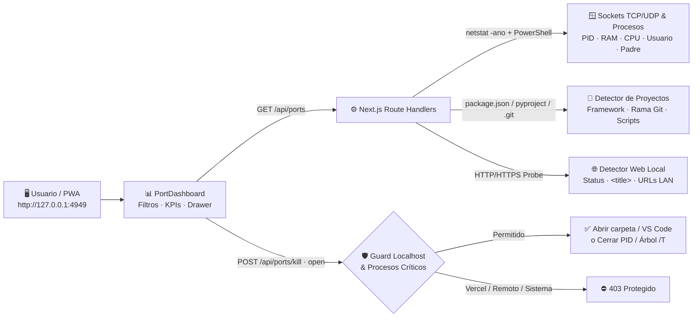
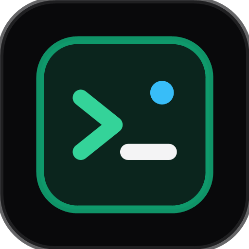

<div align="center">



# ⚡ PortViewer

**Inspector visual de puertos, procesos, proyectos locales y servicios web**  
*Con soporte PWA instalable y acceso directo autoejecutable en Windows, macOS y Linux*

[](https://nextjs.org/)
[](https://react.dev/)
[](https://www.typescriptlang.org/)
[](https://tailwindcss.com/)
[](#-iconos-y-configuración-pwa)
[](#-lanzador-multiplataforma-y-acceso-directo-en-escritorio)

[🚀 Inicio rápido](#-inicio-rápido) • [✨ Funcionalidades](#-funcionalidades-principales) • [🎨 Iconos y PWA](#-iconos-y-configuración-pwa) • [🖥️ Acceso directo OS](#%EF%B8%8F-lanzador-multiplataforma-y-acceso-directo-en-escritorio) • [🔌 API](#-api-routes) • [🛡️ Seguridad](#%EF%B8%8F-seguridad-y-protecciones)

</div>

---

> [!TIP]
> **Puerto dedicado `4949`:** PortViewer corre por defecto en `http://127.0.0.1:4949` para no ocupar el puerto `3000` ni el `5173` mientras trabajas en tus proyectos con Next.js, Vite, React o APIs locales.

> [!NOTE]
> **Modo Local vs. Vercel Cloud:** En tu computadora con Windows, PortViewer escanea tus puertos y procesos reales con control total. Cuando se despliega en **Vercel** (`VERCEL=1`), al ser un entorno serverless en la nube sin acceso a tu máquina local, cambia automáticamente a **solo lectura** con datos de demostración y un aviso informativo.

---

## 🧭 Arquitectura y flujo visual



---

## 🚀 Inicio rápido

```bash
# 1. Instalar dependencias
npm install

# 2. Iniciar en modo desarrollo local (http://127.0.0.1:4949)
npm run dev

# 3. (Opcional) Crear acceso directo autoejecutable en tu Escritorio (Win / macOS / Linux)
npm run shortcut
```

---

## ✨ Funcionalidades principales

| Área | Capacidad | Qué datos muestra |
| :--- | :--- | :--- |
| 🔍 **Escaneo TCP y UDP** | `netstat -ano` + agrupación inteligente IPv4/IPv6 | Puerto, protocolo (`TCP`/`UDP`), estado (`Listen`, `Bound`, `Established`, `TimeWait`, `CloseWait`), alcance (`localhost` vs `network` `0.0.0.0` / `::`) |
| 🧠 **Inspección de procesos** | `Win32_Process`, `Get-Process` y `FileVersionInfo` | **PID**, **nombre**, descripción del binario, empresa/autor, **proceso padre**, **usuario/sesión**, **RAM (MB)**, **CPU (s)**, hora de inicio, **uptime**, título de ventana, ruta del ejecutable y línea de comandos |
| 📁 **Detección de proyectos** | Analiza argumentos y sube desde `node_modules` / `.venv` | Nombre del proyecto, carpeta raíz, rama Git (`.git/HEAD`), gestor de paquetes (`pnpm`, `yarn`, `bun`, `npm`), `scripts` y framework (`Next.js`, `Vite`, `React`, `Vue`, `Nuxt`, `Astro`, `Remix`, `NestJS`, `Express`, `FastAPI`, `Hono`, `Electron`, `Python`, `Rust`, `Go`, `Java`) |
| 🌐 **Sondeo Web (HTTP/HTTPS)** | Petición local ligera con timeout corto (`380 ms`) | Código de estado (`200`, `302`, `404`…), `<title>`, `Content-Type`, cabeceras `Server` / `X-Powered-By`, latencia (ms), enlace directo `http://localhost:<puerto>` y URLs LAN |
| ⚡ **Acciones inmediatas** | Control desde la fila o desde el panel de detalles | **Abrir web**, **Copiar** (URL, PID, ruta, comando), **VS Code** (`code <ruta>`), **Carpeta** (Explorador), **Cerrar proceso** (individual o árbol completo `/T`) |

### 🏷️ Categorías visuales en la interfaz

- 🟢 **`Web`** — Servicios con respuesta HTTP/HTTPS activa o el propio panel PortViewer (`Este panel`).
- 🔵 **`Dev`** — Runtimes y proyectos de desarrollo (`node`, `python`, `java`, `docker`, `ruby`, `go`, `dotnet`, `php`).
- 🟣 **`Base de datos`** — PostgreSQL (`5432`), MySQL/MariaDB (`3306`), Redis (`6379`), MongoDB (`27017`), SQL Server (`1433`), Oracle (`1521`), Elasticsearch (`9200`), etc.
- 🟡 **`Sistema`** — Servicios protegidos de Windows (`135`, `445`, `3389`, `svchost.exe`, `System`, PID `<= 4`).
- ⚪ **`Otro`** — Cualquier otro socket o binario activo.

---

## 📊 Interfaz, controles y feedback visual

- **🎯 5 tarjetas KPI interactivas:** clicables para filtrar al instante por *Puertos abiertos*, *Servicios Web*, *Proyectos detectados*, *Conexiones activas* (`Sockets Raw`) y *Procesos únicos* + duración del escaneo en milisegundos.
- **🗂️ Pestañas y filtros combinables:** `Todos en escucha`, `Servicios Web`, `Proyectos / Dev`, `Bases de datos`, `Sistema` y `Sockets (Raw)` + filtro `Todos / TCP / UDP` + buscador global en tiempo real + ordenamiento (`Web/Dev primero`, `Puerto ↑`, `RAM ↓`, `Proyecto A-Z`, `Proceso A-Z`).
- **🔄 Auto-refresco configurable:** `Off`, `3s`, `5s`, `10s` (por defecto) o `30s`, más botón **Actualizar** con indicador animado y toggles rápidos para **Detectar Web (HTTP)** y **Demo**.
- **🪪 Badges de estado en tiempo real:**
  - 🟢 `Local · <hostname>` con pulso activo cuando escanea tu PC.
  - 🟡 `Vercel Cloud · Solo lectura` cuando corre en la nube.
  - 🔵 `Modo Demo` al previsualizar datos de ejemplo.
- **🪟 Panel lateral `PortDetailDrawer`:** muestra toda la metadata clasificada (*Servicio Web*, *Proyecto Detectado* con lista de scripts, *Datos del Proceso*, *Red y Sockets* con peers remotos conectados) y cierre rápido con `Esc`.
- **🛑 Modal de confirmación + Toasts:** al pulsar **Cerrar**, muestra el comando exacto y permite marcar **Incluir subprocesos (árbol completo `/T`)** para evitar procesos huérfanos en `npm`/`next`/`vite`, confirmando cada acción con notificaciones toast.

---

## 🎨 Iconos y configuración PWA

PortViewer incluye manifest, Service Worker e iconos propios para instalarse en **Chrome / Edge** como aplicación independiente (`display: "standalone"`).

### 🖼️ Vista previa de iconos PWA

| Icono | Archivo | Uso | Especificación |
| :---: | :--- | :--- | :--- |
|  | `public/portviewer-icon-192.png` | Icono estándar PWA | `192×192` PNG (`purpose: "any"`) |
|  | `public/portviewer-icon-512.png` | Alta resolución & Linux `.desktop` | `512×512` PNG (`purpose: "any"`) |
|  | `public/portviewer-icon-maskable-512.png` | Icono adaptable (maskable) | `512×512` PNG (`purpose: "maskable"`) |
|  | `public/portviewer-apple-icon.png` | Apple Web App / iOS / macOS | `180×180` PNG |
| — | `app/favicon.ico` | Pestaña del navegador y `.lnk` | Favicon Windows |

### ⚙️ Piezas técnicas de la PWA

- **`app/manifest.ts`**: expone `/manifest.webmanifest` con `theme_color: "#09090b"`, `background_color: "#09090b"` y `display: "standalone"`.
- **`public/portviewer-sw.js`**: Service Worker minimalista (`skipWaiting`, `clients.claim`) que **nunca cachea `/api/`** ni datos sensibles de tu equipo, y muestra una página offline oscura cuando el servidor local está apagado.
- **`next.config.ts`**: sirve `/portviewer-sw.js` con `Cache-Control: no-cache, no-store, must-revalidate` y `Content-Security-Policy: default-src 'self'`.
- **`components/PortViewerServiceWorker.tsx`** y **`components/usePortViewerInstall.ts`**: registran el SW y habilitan el botón **Instalar app** (cambiando a **PWA instalada** en modo `standalone`).

### 🧩 Catálogo de iconos vectoriales (`components/icons.tsx`)

Todos los iconos de la interfaz son SVG ligeros sin dependencias externas:  
`RefreshIcon` · `GlobeIcon` · `ExternalLinkIcon` · `FolderIcon` · `CodeIcon` · `PowerIcon` · `CopyIcon` · `CheckIcon` · `SearchIcon` · `InfoIcon` · `ShieldIcon` · `DatabaseIcon` · `TerminalIcon` · `CloseIcon` · `AlertIcon`

---

## 🖥️ Lanzador multiplataforma y acceso directo en Escritorio

Crea un acceso directo autoejecutable en tu Escritorio para iniciar PortViewer en segundo plano (sin dejar terminales abiertas) y abrir `http://127.0.0.1:4949` con un doble clic:

```bash
npm run shortcut
```

El instalador (`scripts/install-shortcut.mjs`) detecta automáticamente tu sistema operativo:

| Sistema Operativo | Script instalador | Archivo generado en Escritorio | Lanzador ejecutado |
| :--- | :--- | :--- | :--- |
| 🪟 **Windows** | `scripts/Install-PortViewerShortcut.ps1` (`npm run shortcut:win`) | `PortViewer.lnk` | `scripts/Start-PortViewer.ps1` (Mutex `Local\PortViewer4949`, oculto en segundo plano, logs en `.portviewer/`) |
| 🍎 **macOS** | `scripts/install-portviewer-shortcut.sh` (`npm run shortcut:unix`) | `~/Desktop/PortViewer.app` | `scripts/start-portviewer.sh` (`nohup`, abre con `open`, sin ventana de Terminal persistente) |
| 🐧 **Linux** | `scripts/install-portviewer-shortcut.sh` (`npm run shortcut:unix`) | `PortViewer.desktop` + `~/.local/share/applications/` | `scripts/start-portviewer.sh` (`nohup`, marca `metadata::trusted true` en GNOME, abre con `xdg-open`) |

> [!TIP]
> También puedes usar `npm run shortcut -- --start` para crear el acceso directo y abrirlo de inmediato, o `npm run launch` (`--no-browser` para solo levantar el servidor en segundo plano).

---

## 🔌 API Routes

| Endpoint | Método | Parámetros / Body | Respuesta / Acción |
| :--- | :---: | :--- | :--- |
| `/api/ports` | `GET` | `?probe=1\|0`, `?demo=1` | Devuelve `{ runtime, entries, allSockets, stats }` con procesos, proyectos y sondeo HTTP. |
| `/api/ports/kill` | `POST` | `{ pid, processName?, includeTree? }` | Ejecuta `taskkill /PID <pid> /F` (o `/T /F` si `includeTree: true`). |
| `/api/ports/open` | `POST` | `{ targetPath, action: "explorer" \| "vscode" }` | Abre la carpeta del proyecto/ejecutable en el Explorador o en VS Code. |
| `/api/health` | `GET` | — | Healthcheck rápido `{ ok: true, app: "portviewer", pid, isVercel, nodeVersion }`. |

---

## 🛡️ Seguridad y protecciones

- **Validación estricta de origen (`lib/security.ts`):** `verifyLocalActionRequest` rechaza cualquier petición a `/api/ports/kill` o `/api/ports/open` cuyo `Host` u `Origin` no sea `localhost`, `127.0.0.1` o `::1` (evita CSRF desde sitios externos).
- **Lista de procesos críticos protegidos:** impide terminar PID `<= 4`, procesos esenciales de Windows (`System`, `Idle`, `smss.exe`, `csrss.exe`, `wininit.exe`, `services.exe`, `lsass.exe`, `winlogon.exe`, `svchost.exe`, `dwm.exe`, `fontdrvhost.exe`, etc.) y el propio proceso de PortViewer (`process.pid`).
- **Bloqueo en Vercel:** cualquier acción destructiva o de sistema devuelve `403` si `VERCEL=1`.
- **Robots (`app/robots.ts`):** bloquea el rastreo de `/api/`.

---

## 📁 Estructura del proyecto

<details>
<summary>Ver árbol completo de archivos</summary>

```text
PortViewer/
├── app/
│   ├── api/
│   │   ├── health/route.ts                # Healthcheck del servidor local
│   │   └── ports/
│   │       ├── route.ts                   # GET /api/ports
│   │       ├── kill/route.ts              # POST /api/ports/kill
│   │       └── open/route.ts              # POST /api/ports/open
│   ├── favicon.ico                        # Favicon e icono .lnk
│   ├── globals.css                        # Estilos globales y tema oscuro
│   ├── layout.tsx                         # Metadata, Viewport y Apple Web App
│   ├── manifest.ts                        # Web App Manifest (/manifest.webmanifest)
│   ├── page.tsx                           # Página principal + registro SW
│   └── robots.ts                          # Reglas robots.txt
├── components/
│   ├── icons.tsx                          # Iconos SVG inline
│   ├── port-dashboard.tsx                 # Dashboard principal interactivo
│   ├── port-detail-drawer.tsx             # Panel lateral de inspección detallada
│   ├── PortViewerServiceWorker.tsx        # Registro cliente del Service Worker
│   └── usePortViewerInstall.ts            # Hook de instalación PWA
├── lib/
│   ├── demo-data.ts                       # Datos de ejemplo para Vercel / Modo Demo
│   ├── port-scanner.ts                    # Escáner Windows + proyectos + HTTP probe
│   ├── security.ts                        # Validación localhost y procesos protegidos
│   └── types.ts                           # Tipos TypeScript compartidos
├── public/
│   ├── portviewer-apple-icon.png          # 180x180
│   ├── portviewer-icon-192.png            # 192x192
│   ├── portviewer-icon-512.png            # 512x512
│   ├── portviewer-icon-maskable-512.png   # 512x512 maskable
│   └── portviewer-sw.js                   # Service Worker
├── scripts/
│   ├── install-portviewer-shortcut.sh     # Acceso directo en macOS y Linux
│   ├── install-shortcut.mjs               # Instalador multiplataforma de acceso directo
│   ├── Install-PortViewerShortcut.ps1     # Acceso directo en Windows (.lnk)
│   ├── start-local.mjs                    # Lanzador multiplataforma en segundo plano
│   ├── start-portviewer.sh                # Lanzador en macOS y Linux
│   └── Start-PortViewer.ps1               # Lanzador en Windows
├── .gitattributes                         # Normalización LF/CRLF para .sh/.ps1
├── .gitignore                             # Ignora .portviewer/, .next/, node_modules/
├── next.config.ts                         # Cabeceras SW y configuración Turbopack
└── package.json                           # Scripts y dependencias
```

</details>

---

## 📜 Scripts disponibles

| Comando | Descripción |
| :--- | :--- |
| `npm run dev` | Inicia el servidor de desarrollo en `http://127.0.0.1:4949` |
| `npm run dev:viewer` | Alias explícito para desarrollo en `http://127.0.0.1:4949` |
| `npm run build` | Compila la versión de producción (`next build`) |
| `npm run start` | Inicia la versión de producción en `http://127.0.0.1:4949` |
| `npm run start:viewer` | Alias explícito para producción en `http://127.0.0.1:4949` |
| `npm run lint` | Ejecuta ESLint (`eslint`) |
| `npm run typecheck` | Verifica tipos con TypeScript (`tsc --noEmit`) |
| `npm run launch` | Arranca PortViewer en segundo plano y abre el navegador (Win / macOS / Linux) |
| `npm run shortcut` | Crea el acceso directo autoejecutable en el Escritorio (Win / macOS / Linux) |
| `npm run shortcut:win` | Crea el acceso directo `.lnk` en Windows |
| `npm run shortcut:unix` | Crea el acceso directo `.app` (macOS) o `.desktop` (Linux) |

---

## ☁️ Comportamiento en Vercel

Este repositorio puede desplegarse directamente en **Vercel** (rama principal `master`) para mostrar la interfaz o compartir una vista previa.  
Al correr dentro de un contenedor serverless en la nube (`VERCEL=1`), Vercel **no tiene acceso a los puertos ni procesos de tu computadora local**, por lo que PortViewer muestra automáticamente el banner de solo lectura y carga datos de demostración seguros.
